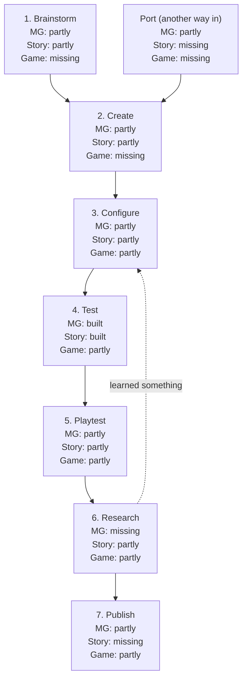

# Arcwright Game Toolkit: Inventory, Journeys And Draft Proposal

> Current version: v0.3 DRAFT
> Last updated: 2026-11-27
> Status: Draft, **pending founder approval**. Nothing here is approved build scope.
> Canonical path: docs/design/tooling/game-toolkit-proposal.md
> Task: [AW-373](../../roadmap/tasks/AW-373-make-the-game-mini-game-and-playtest-toolkit-a-product.md), [issue #523](https://github.com/nickejanssen/arcwright/issues/523), steps 1 and 2.

## The short answer

- **What you asked for:** mini-games first; a written guide, "ask the toolkit" through any AI as the main way in, and one terminal command underneath; tools that ask, offer and check while you keep the final story text; built for us now to a standard you would sell.
- **What exists:** mini-games are furthest along. One game (Battle of Wits) plays on phones over Wi-Fi. Stories have a fairness checker. Making a whole new game has no tool.
- **What you would get:** the full list is in [Everything you will be able to do](#everything-you-will-be-able-to-do). Please review that list before approving.
- **Build order:** the AW-372 play command first, then the rest of the mini-game path. The order after mini-games is a recommendation you have not approved.
- **Status:** your six interview answers are recorded below. The proposal as a whole is **not yet approved**, and nothing is built.

## The lifecycle in one picture

Each box shows where today's tools stand for a **mini-game (MG)**, a **story** and a whole **game**. "Port" means bringing in something that already exists.



**Built** means a tool or procedure exists, not that it has been used in play. The evidence for every box is in [Evidence: journeys](#evidence-journeys).

### How you will see where one thing stands (proposed)

The **standing board**. Ask "where does Lantern Dash stand?" or run `arcwright minigame status lantern-dash`. `arcwright toolkit status` shows every game, mini-game and story at once. Invented example:

```text
Lantern Dash  (mini-game, version 0.1.0, label: draft)

 1 Brainstorm   done         brief saved
 2 Create       done         package loads
 3 Configure    done         2 to 4 players, 90 seconds
 4 Test         needs work   1 rule check fails
 5 Playtest     not started
 6 Research     no record
 7 Publish      blocked      needs steps 4 and 5

 Next: fix the failing check. Run: arcwright minigame check lantern-dash
```

Each mark comes from a file or a saved check result. Where nothing was saved, it says "no record". It never guesses. Changing a package makes older test and playtest marks show as out of date.

## Your answers

Quoted word for word from [issue #523](https://github.com/nickejanssen/arcwright/issues/523), 27 November 2026. "What it means here" is this proposal's reading.

| # | Question | Your words | What it means here |
|---|---|---|---|
| Q1 | After the play command, which piece comes first? | "Mini-games first" | Pieces 1 to 6. The order after them is still a recommendation |
| Q2 | What is the front door? | "Written guide explains how to use the tool kit. Ask the toolkit is the main way through any AI. Having back up options through terminal is good considering the AI toolkit likely needs these for deterministic operation and the human can use it if that is there preference or if they want to customize their flows" | Three layers: guide, AI, terminal (inferred reading) |
| Q2 follow-up | One terminal entry point, or the separate tools? | "Im cool with one entry point, but make sure whatever direction this takes, it is the highest quality, the industry's best standards, what a billion dollar video game company would do at this stage, and makes for a seamless, intuitive, practical, and maximum value experience." | One entry point, a thin layer over existing tools. The quality bar applies to everything |
| Q3 | How much should the tools write? | "the tools ask, offer options and check, while final story text stays yours. That being said, the bar is the same: the highest quality, the industry's best standards, what a billion dollar video game company would do at this stage, and makes for a seamless, intuitive, practical, and maximum value experience. This should be easy to visualize too. IT should be extremely easy to understand as well." | No tool writes final story text. Pictures and plain examples are required |
| Q4 | Who is version one for? | "Just us right now, but this must be made availble once we start selling the engine. Thats why its important to build tools we love right now because others using arcwright to build will love them too. Also, we must build with scale in mind. I am relying on you to do a lot, but a lot if things under the hood are still lost on me. Dont cut corners now just because we are making this aviable to purchasers yet. It must be great for my use and I should love it so that when we sell our products, the customer has somethign that has been tested thoroughly and they can trust that I love the tools, dashboards, forms, CLI, AI plugins/skills/etc, and our documentaition is world class and makes it effortless to get started with Arcwright, fall in love with it, and want to use it with all of your games." | You and your AI helpers, built to a sellable standard and with scale in mind. Opening it to customers is intent, not yet approved scope |
| Q5 | Relabel the two "ready" games with stub rules as drafts, with AW-367? | "Yes, relabel" | `crime-scene-smash` and `evidence-locker-402` become drafts, together with [AW-367](https://github.com/nickejanssen/arcwright/issues/511). Its task file does not mention this yet. The old Couch Race arc uses both, so that change must handle the arc |
| Q6 | Start the story proposal right after this one is approved? | "Yes, right after. PLease outline everything we will be able to do with the story tools prior to building. Smae goes for any tools. I want to make sure the features are al availble and usable in the right way" | Story proposal follows approval. Every tool gets a full outline for your review before it is built |

## The proposal

Everything here that your answers do not cover is a recommendation.

### Three layers

| Layer | What it is | Rule |
|---|---|---|
| Ask the toolkit (main way in) | You say what you want to any AI that works in the repository | The AI runs the terminal commands and shows you previews and results |
| Terminal command (backbone) | One entry point, `arcwright <area> <action> <target>` | A thin layer over the existing tools. Rules live in Python, once |
| Written guide (explains it) | A start page and one guide per journey in `docs/toolkit/` (folder name proposed) | Commands in guides are tested automatically |

Making `arcwright` a command you can type needs a small packaging change in `pyproject.toml` and no new dependency (inferred; the piece 2 plan must confirm it).

### One source for every AI

The source stays `docs/skills/<name>/SKILL.md`; each AI gets a short pointer, and a test fails when a pointer's description or target drifts.

| Option for Claude Code | Trade-off |
|---|---|
| **A. `.claude/commands/` files (recommended)** | Already an allowed tracked path; this session lists those commands as skills Claude can pick up |
| B. `.claude/skills/` files | Mirrors Codex exactly, but needs a change to `AGENTS.md` and `.gitignore` |
| C. Generated pointers | More machinery for a handful of short files |

Codex keeps its pointers. "Any AI" beyond Claude Code and Codex: the terminal commands and guide work for any AI that can run commands and read files (inferred); each further AI needs its own check.

### Guides

| Guide | Contents |
|---|---|
| Start here | The lifecycle picture; what you want to do, what to say, what to type; what does not work yet |
| Make a mini-game | Brainstorm to publish. Replaces the out-of-date parts of the current author guide, which keeps the screen-code reference |
| Playtest and learn | Set up, run, collect, read results, decide |
| Make a story | Written after the story proposal |
| Make a game | Written when the new-game piece exists |

### Quality bar: acceptance criteria for every piece

1. Commands follow area, action, target: `arcwright minigame check lantern-dash`.
2. `--help` on every level is written in plain words, with an example.
3. People get readable output and the AI gets JSON (`--json`), both produced from the same rules.
4. Anything that changes files or publishes shows a preview first and changes nothing until you confirm.
5. Every error says what went wrong and what to do next.
6. Commands in guides are run by an automated test, so a guide cannot go stale unnoticed.
7. A full outline of what the piece lets you do is reviewed by you before it is built (Q6).
8. Your quality words apply: "seamless, intuitive, practical, and maximum value". You judge this by using the piece.
9. Nothing game-specific enters `engine/`. No new dependency, deploy or spending without approval.

Today's tools only partly meet this: some already offer `--json`, and no preview step was found in `scaffold` or `archive` (verified by reading their options).

### Build pieces, in order

Sizes (inferred): **S** about a day of one build session, **M** one to three, **L** longer. Each piece gets its own task, issue and plan approval **after** this proposal is approved. Builds start after the 1 December test (AW-373 task record, which cites D-156).

| # | Piece | Size | Done when (plus the quality bar) |
|---|---|---|---|
| 1 | **AW-372** play command | S to M | Battle of Wits and one more game start with the same command; a package that cannot play says why in one line |
| 2 | Terminal entry point and standing board | M | `arcwright` runs the existing mini-game and playtest tools; the board shows correct marks for invented examples |
| 3 | Ask the toolkit: one source for every AI. Do with AW-312 | S | Claude Code and Codex both offer it; the drift test works; ADR 0018 text fixed |
| 4 | Written guide: start page and picture | S | Someone new can find the right command from the start page |
| 5 | Mini-game lifecycle: brainstorm to publish, honest labels, guide, old preview command settled | M | A made-up game goes from idea to ready by following the guide; a ready label is refused without real rules |
| 6 | **AW-349** (already filed): port one browser game | M | Port time measured and written into the guide |
| 7 | Playtest and results (ratings need AW-354) | M to L | One command gives a spoiler-safe summary by game and version |
| 8 | Story tools: scoped by the story proposal | set there | Set there |
| 9 | Remove Nightcap-only assumptions from the tools | M | An invented second game passes the same steps |
| 10 | New-game starter and arc check, then the game guide | M to L | A made-up game is created, checked and run headless |

Recommendation: do piece 9's checks as each earlier piece is built (test with an invented second game), so piece 9 stays small.

**AW-372 corrections for its plan (verified):**

- The task file lists an `onboard` command. The command is `onboard-browser`.
- The task asks `status` or `onboard` to suggest `play`. `status` takes an import session ID, not a package path, and `onboard-browser` stops at "Imported", before a game is playable. Recommended fix: `validate` suggests `play` for a playable package, and later the standing board does too. This changes the wording of acceptance criterion 5, so the plan must say so.
- The room fixes Battle of Wits screen code in `standalone-battle-of-wits.ts`, not only values in the Python script.
- Tell Me Something True is the only other package with both real rules and screen code; it needs 4 to 8 players.

## Everything you will be able to do

All commands and screens below are **proposed**; none of the `arcwright` commands exists today. Names are invented: mini-games `lantern-dash` and `paper-kites`, story `orchard-case`, game `tidepool`. **Later** means not in version one. Every row also follows the quality bar.

### 1. Play command (AW-372)

| You say to the AI | Terminal | You see | It checks or refuses |
|---|---|---|---|
| "Let us play Lantern Dash" | `arcwright minigame play lantern-dash` | The address for this PC and for phones, and how to stop | Refuses with the one missing piece (rules, screen code, content) |
| "Use another port" | `arcwright minigame play lantern-dash --port 8800` | The new addresses | Refuses a port already in use and says how to pick another |
| In the room: join, start, answer, rejoin, play again | Browser buttons | Names, the game, results and standings | Player limits come from the package; no late joining; hidden answers never reach phones early |
| "Stop the room" | Ctrl+C | Room closed, seats cleared | |
| Later: save the results of a round (see piece 7) | | | |
| Later: play with people outside your Wi-Fi | | | Needs hosting approval |

AW-372 as filed adds `minigame_tool.py play`; piece 2 puts `arcwright` in front of it.

### 2. Terminal entry point and standing board

| You say to the AI | Terminal | You see | It checks or refuses |
|---|---|---|---|
| "What can the toolkit do?" | `arcwright toolkit help` | Areas, actions and examples; what is not built yet | Unknown command suggests the closest one |
| "Where does everything stand?" | `arcwright toolkit status` | One line per game, mini-game and story, with its next step | Shows "no record" instead of guessing; never shows story solutions |
| "Where does Lantern Dash stand?" | `arcwright minigame status lantern-dash` | The seven-step board and next command | Marks out-of-date results |
| "Is my computer set up for this?" | `arcwright toolkit check` | What is installed and what is missing, with the fix | Changes nothing |
| "Give me that as data" | add `--json` | The same facts for scripts and your own flows | |
| Later: the board as a dashboard page | | | |

### 3. Ask the toolkit

| You say to the AI | Terminal | You see | It checks or refuses |
|---|---|---|---|
| "I want to make a game where people race to light lanterns" | `arcwright minigame ideas list` gives the AI the idea list and questions | One question at a time, options with a recommendation, then a short brief | Writes nothing until you agree; final story text stays yours |
| "What should I do next with Paper Kites?" | `arcwright minigame status paper-kites` | The next step, why, and an offer to do it | Never treats your silence as approval |
| "Do it" | The matching command | The preview first, then the result | Asks again before anything that publishes, deploys or costs money |
| "Show me the command so I can run it myself" | Any | The exact command and what it will change | |
| The same words in Claude Code or Codex | | The same behaviour | A test fails if their instructions drift |
| Later: other AI products, packaged plugins | | | Customer-facing ones need approval |

### 4. Written guide

| You say to the AI | Terminal | You see | It checks or refuses |
|---|---|---|---|
| "Explain the toolkit" | `arcwright toolkit guide` | The start page: picture, what you want, what to say, what to type | |
| "How do I make a mini-game?" | `arcwright toolkit guide minigame` | Steps with working examples and what does not work yet | An automated test runs the commands |
| "How do I run a playtest?" | `arcwright toolkit guide playtest` | The playtest steps and evidence limits | |
| Later: searchable documentation site for customers | | | Needs approval |

### 5. Mini-game lifecycle

| You say to the AI | Terminal | You see | It checks or refuses |
|---|---|---|---|
| "Brainstorm a two player observation game" | `arcwright minigame ideas list --players 2` | Options, a recommendation, a first playtest question; a saved brief | Flags a repeat of an existing mechanic |
| "Create Lantern Dash" | `arcwright minigame new lantern-dash` | Preview of new files, then a draft package | Refuses a taken or badly formed name |
| "Add the rules" | Built by an AI build session from the brief | A plan for your approval, then tested rules | A one-command rules builder is **later** |
| "Import this browser game" | `arcwright minigame import ./kites-source` | What was found, what is uncertain, questions for you | Keeps the original unchanged; stops at "Imported" and says so |
| "Continue that import" / "Where is it?" | `arcwright minigame import-resume <id>`, `import-status <id>` | The saved import and its open questions | Refuses an unknown ID |
| "Make rounds 60 seconds for 2 to 4 players" | `arcwright minigame set lantern-dash --seconds 60 --players 2-4` | Before and after, then saved | Refuses impossible values; a version already playtested needs a new version |
| "Make a new version" | `arcwright minigame new-version lantern-dash` | A copy with the next number | Never edits a playtested version |
| "Check it" / "Check them all" | `arcwright minigame check lantern-dash`, `check all` | Pass or fail per check, in plain words; covers every label, unlike today's catalogue check | Package loads, rules exist, privacy, player limits, fallback, tests |
| "Preview the screens only" | `arcwright minigame preview lantern-dash` | Phone and TV screens with pretend states, clearly marked | Never counts as a playtest. Whether the old preview is replaced or retired is decided in this plan |
| "Mark it ready for playtest" | `arcwright minigame promote lantern-dash playtest` | What changes and the evidence behind it | One step at a time; refuses without real rules and passing checks |
| "Mark it ready for use" | `arcwright minigame promote lantern-dash active` | Same, plus your sign-off | Refuses without a recorded playtest and your approval |
| "Retire it" | `arcwright minigame retire paper-kites` | Which games use it, then the change | Refuses while a game still uses it |
| "Add it to a game" | `arcwright minigame add-to lantern-dash tidepool` | The preview of that game's setup change | Refuses drafts |
| Later: sharing packages between games or with outside creators; a visual editor | | | Needs approval |

### 6. Port a browser game (AW-349)

| You say to the AI | Terminal | You see | It checks or refuses |
|---|---|---|---|
| "Port this game" | `arcwright minigame import ./kites-source`, then build sessions | A baseline of the original, a proposed port plan, then a playable package | Needs your choice of source and plan approval; checks you may use its assets |
| "Compare it with the original" | `arcwright minigame compare paper-kites` | Differences in rules, timing and feel, and time spent | Uses the same recorded inputs for both |
| "Use it in a game too" | `arcwright minigame add-to paper-kites tidepool` | The same version, standalone and in the game | No second copy of the scoring rules |
| Later: automatic porting | | | One port proves nothing general |

### 7. Playtest and results

| You say to the AI | Terminal | You see | It checks or refuses |
|---|---|---|---|
| "List our playtests" | `arcwright playtest list` | Current, draft and archived tests | |
| "Start a new test for Tidepool" | `arcwright playtest new tidepool-playtest-v0.1` | Preview of the entry, then a draft | Neutral titles only; never writes test story text |
| "Add the test page we already approved" | `arcwright playtest register tidepool-playtest-v0.1` | Preview, then registered | Never rewrites those files |
| "Is it ready for testers?" | `arcwright playtest check tidepool-playtest-v0.1` | Page, survey link and telemetry checks; what only a real device can prove | Never claims a device or live check it did not do |
| "Build the pages" | `arcwright playtest build` | A local copy to open | Changes nothing public |
| "Make this the current test" (new: no command today) | `arcwright playtest make-current tidepool-playtest-v0.1` | Before and after | Needs your approval |
| "Archive the old one" | `arcwright playtest archive tidepool-playtest-v0.0` | Preview, then archived | Keeps the pages and history |
| "Publish it" | `arcwright playtest publish tidepool-playtest-v0.1` | What will become public and the pull request that does it | Publishing happens when merged; it never merges without you |
| "Save how that round went" (new data: needs your approval) | `arcwright minigame play lantern-dash --save-results` | A saved round: version, player count, result, your notes | No names or private answers saved without an approved rule |
| "What did testers tell us?" | `arcwright playtest results tidepool-playtest-v0.1` | Counts, themes, how strong the evidence is, open decisions | Reads a survey file you provide; never mixes survey versions silently |
| "Compare versions" | `arcwright playtest compare tidepool-v0.1 tidepool-v0.2` | Side by side by game and version | Says when the sample is too small to conclude |
| Later: reading the survey service directly; a results dashboard; a playtest lab for customers | | | Each needs approval |

### 8. Story tools (preview only)

The full outline comes in the story proposal, before any building (Q6). Expected starting list:

| You say to the AI | Terminal | You see | It checks or refuses |
|---|---|---|---|
| "Help me brainstorm a story" | `arcwright story ideas orchard-case` | Questions and options; your choices saved | Final story text stays yours |
| "Start a blank case" | `arcwright story new orchard-case` | A blank file to fill in | Keeps solutions in the private file |
| "Is it fair?" | `arcwright story check orchard-case` | Rule names, pass or fail and counts | Spoiler-safe by default |
| "Set up version 1a style rules" | Defined in the story proposal | | |
| "Try it" / "How did it play?" | `arcwright story play orchard-case`, `results` | A running game; a spoiler-safe summary | |
| Later: story publishing to players | | | Not designed |

### 9. Works for any game

| You say to the AI | Terminal | You see | It checks or refuses |
|---|---|---|---|
| "Make Paper Kites for Tidepool, not Nightcap" | `arcwright minigame new paper-kites --game tidepool` | The package in Tidepool's folder | Refuses an unknown game |
| "Show only Tidepool" | `arcwright toolkit status --game tidepool` | That game's board | |
| Pieces 1, 2, 5 and 7 for any game | Same commands | Same behaviour | A test with an invented second game |
| Later: one mini-game shared by several games | | | Needs a design decision |

### 10. New game

| You say to the AI | Terminal | You see | It checks or refuses |
|---|---|---|---|
| "I have an idea for a new game" | `arcwright game ideas tidepool` | Questions, options and a saved brief | Your design and story choices stay yours |
| "Create Tidepool" | `arcwright game new tidepool` | Preview, then a starter folder and rules file | Refuses a taken name |
| "Check its setup" | `arcwright game check tidepool` | Pass or fail per rule | Missing mini-games, player counts, dead ends |
| "Run it with pretend players" | `arcwright game test tidepool --players 4` | Where it reached and where it stuck | Says this is not a human playtest |
| "Play it" | `arcwright game play tidepool` | Addresses for TV and phones | Refuses and lists what is missing |
| "Where does it stand?" | `arcwright game status tidepool` | The seven-step board | |
| Later: releasing a game to players; a visual flow editor; templates for customers | | | Needs approval |

## Story configurations (a separate product track)

Added at the founder's request, relayed by the orchestrator session on 27 November 2026. His words as relayed: "Consider what this should look like for story configurations as well. I consider that a different type of product for arcwright, but if there are learnings and cross-utilization needed, then we should flag that."

A **story configuration** here means a case plus one setup of how it is played, such as version 1a (inferred reading). **This section does not design that product.** It flags what the two tracks should share. You decided (Q6) that its own proposal starts right after this one is approved, and that it outlines everything you will be able to do before any story tool is built. Build piece 8 belongs to that proposal.

**Where it stands (verified).** Five versions, 1a to 1e, were approved on 20 November (D-148, [version sheets](../session-1-variants/README.md)). Each is one setup of the arc file, the file holding a game's rounds and rules. Of the five, only 1a has such a file registered (`nightcap/agency-race-1a.arc.json`, `config/arcs.json`). [AW-356](https://github.com/nickejanssen/arcwright/issues/465), which builds the setups and the run sheet, is open.

| Shared item | What should be shared | What stays with stories (inferred) | Label |
|---|---|---|---|
| Validation | One way to say "does this load and is it fair", with the same pass or fail output. Today the case checker reads the round order from an arc, mini-games have their own validator, and no command checks an arc file alone | Fairness rules and spoiler safety | Existing tools verified; sharing inferred |
| Play and preview command | One habit: name a thing, get a running room and the phone address. AW-372 plans it for a mini-game; AW-367 plans it for case 1 | Choosing the case, version and seats | Task records verified; sharing inferred |
| Playtest harness | Two things share this name: scripted session runs (`engine/harness/`) and the Playtest Lab page checks. Both can serve either track | Made-up players and routes that suit a mystery | Both verified; use for versions not tried |
| Evidence and research | One record of what was played: game, case, version, group, mini-game version. Play records already work for any game; version tags and ratings are AW-354 | Which questions compare versions | Records and task verified; one shared report inferred |
| Guide format | Same shape for every guide: goal, steps, commands that run, what is missing | Writing craft | Inferred |
| One source for Claude and Codex | Same source-plus-pointer rule and the same drift test | Rules for who may read case files | Pointer pattern verified for Codex; story use inferred |
| Mini-game choice | A version picks mini-games by name and version, so the toolkit's "ready" check and player counts feed story setup | Which game fits which moment | Binding verified in the 1a arc file; the "ready" check is missing |

## How the toolkit grows into the creator products

**What is committed (verified).** [PRD requirements](../../prd/02-requirements.md) line 94: at the first horizon (H1) a developer gets a web API, a TypeScript web SDK generated from the API description, a hosted dashboard with live knowledge graph inspection, documentation, and Nightcap as the public example. [PRD scope](../../prd/03-scope.md) line 46 and D-035 stage the visual creator tools, called Visual Storyworld, in five phases: (1) inspection, (2) structured editing during H2 preparation, (3) live preview and debugging at H2 launch, (4) a visual flow editor, (5) asset libraries, a marketplace if there is demand, and AI-assisted authoring. The MVP definition in the requirements file ranks the developer dashboard and authoring interface lowest and defers them until the player experience is proven.

**Where that stands.** The session routes in the API take a registered arc ID; no route for uploading an arc definition was found. SDK source exists in `sdk/src/`; no generation step was found in its package file. No knowledge graph inspection screen was found in `dashboard/src/screens/`, and [AW-236](https://github.com/nickejanssen/arcwright/issues/89) is open (verified by listing and search).

The mapping below is a recommendation (inferred). It approves nothing in the right-hand column.

| Toolkit piece | Could grow into | Build it this way now | Would be new product scope: needs your approval |
|---|---|---|---|
| 1 Play command (AW-372) | Phase 3 live preview | Room logic separate from the command, driven by the package | Hosting rooms for outside developers |
| 2 Terminal entry point and standing board | Developer documentation; hosted dashboard | One command grammar; same facts as text and JSON | A shipped public command-line product; a status screen for customers |
| 3 Ask the toolkit | No committed product | Plain written procedures | Shipping AI skills or plugins to developers; an agent that helps them author (nearest commitment is phase 5) |
| 4 Written guide | Developer documentation | Readable without any AI; commands tested | None for internal guides |
| 5 Mini-game lifecycle | Developer documentation | Label rules checked in Python | Third-party mini-game packaging or submission (the mini-game skill calls it out of scope) |
| 6 Port proof (AW-349) | Sample projects (H2 preparation) | Record real effort and limits | An importer or porting service for developers |
| 7 Playtest and results | Hosted dashboard; phase 3 debugging | Report built on game-neutral play records | **A developer-facing playtest lab, forms or research product** |
| 8 Story tools | API arc input; phase 2 arc and character editing | Checks return structured results a screen or the API could show | A public story authoring product beyond the staged phases |
| 9 Any-game support | Needed by every row above | No game names in tools | None found |
| 10 New-game starter and arc check | API arc input; phases 2 and 4 | One arc check that a command, the API and an editor could all call | Public templates or a starter kit |

You said the toolkit "must be made availble once we start selling the engine" (Q4). That is recorded as intent. Selling or shipping any right-hand item still needs its own approval.

**Habits that keep the internal tools from being thrown away (recommendation):** write each rule once in Python and keep commands thin; offer a machine-readable result beside the plain one; keep game names out; treat the existing arc and package files as the only formats. None of this builds anything for outsiders now.

## What still needs your approval

1. This proposal, including the outline above. Please mark anything missing or wrong.
2. The order after mini-games: results, then stories, then whole games (recommendation; the story proposal itself starts right after approval).
3. The Claude Code pointer option (A recommended) and the guide folder name.
4. Later, each build piece's own plan, and anything marked as new scope.

Approving this files each piece as a task and GitHub issue. It does not approve any build.

The sections below are the evidence behind this proposal.

## How to read this

| Word | Meaning |
|---|---|
| **Built** | A tool or written procedure for the step exists. This does not mean anyone has used it in a real game. |
| **Partly** | Something exists, but it covers only some cases or needs hand work. |
| **Missing** | No tool or procedure was found. |
| **Verified** | Read in the file, or run, on 27 November 2026 at `main` commit `848bed6` (the story and creator product sections at `4118aaa`). |
| **Inferred** | A conclusion drawn from what was read. Not directly proven. |

**Run on 27 November:** `pytest engine/tests/test_minigame_tool.py scripts/tests/test_playtest_tool.py scripts/tests/test_playtest_skill_contract.py` (26 passed); `playtest_tool.py --json validate` (ok) and `list`; `minigame_tool.py validate` on all six package folders under `nightcap/mini_games/` other than `_fixtures` (all load); `--help` for the tool commands and the case checker.

**Not run:** the Wi-Fi room, `scaffold`, `onboard-browser`, the preview command, the rehearsal stack, any dashboard test, anything on a TV or phone. Nothing was observed in Codex. No file under `nightcap/cases/` was opened.

## Evidence: inventory

### Skills (instructions an AI agent follows)

| Skill | Source | What it covers | Codex pointer | Claude Code |
|---|---|---|---|---|
| Mini-game | [`docs/skills/arcwright-minigame/SKILL.md`](../../skills/arcwright-minigame/SKILL.md) (450 lines), `scripts/minigame_tool.py`, `agents/openai.yaml` | Design intake, scaffold or import, validate, fit-check, test, promote | `.agents/skills/arcwright-minigame/` | none |
| Playtest steward | [`docs/skills/arcwright-playtest-steward/SKILL.md`](../../skills/arcwright-playtest-steward/SKILL.md) | Front desk for Playtest Lab work; routes to the three below | `.agents/skills/arcwright-playtest-steward/` | none |
| Playtest harness | [`docs/skills/arcwright-playtest-harness/SKILL.md`](../../skills/arcwright-playtest-harness/SKILL.md) | Checks a test page before testers use it | `.agents/skills/arcwright-playtest-harness/` | none |
| Playtest research | [`docs/skills/arcwright-playtest-research/SKILL.md`](../../skills/arcwright-playtest-research/SKILL.md) | Survey versions, tester feedback, evidence limits | `.agents/skills/arcwright-playtest-research/` | none |
| Playtest publishing | [`docs/skills/arcwright-playtest-publishing/SKILL.md`](../../skills/arcwright-playtest-publishing/SKILL.md) | Catalogue, site build, archive, public pages | `.agents/skills/arcwright-playtest-publishing/` | none |

Claude Code: `.claude/commands/` holds only `doc-review`, `implement`, `review-pr` and `scribe`, and there is no `.claude/skills/` folder (verified). None of the five skills appeared in this Claude session's skill list (verified). The `playtest-ops-sme` and `nightcap-sme` helpers in `.claude/agents/` answer questions from documents; they do not run these workflows.

### Exactly how the two copies differ

- Each `.agents/skills/<name>/SKILL.md` is 8 or 9 lines: a name, a description and "read the file under `docs/skills/`". [`.agents/skills/README.md`](../../../.agents/skills/README.md) says this is deliberate, to prevent drift. So the missing `scripts/` and `agents/` folders are expected (verified).
- All five pointers have the right name and point to the right source (verified).
- **Mini-game description differs:** the pointer cites decision record ADR 0009. The source cites ADR 0018, which replaced it. The pointer was last changed 22 June 2026; the source on 18 November 2026.
- **All four playtest descriptions differ:** pointers say "Use when ...", sources describe what the skill does. Both read as correct, but nothing keeps them in step.
- [`scripts/tests/test_playtest_skill_contract.py`](../../../scripts/tests/test_playtest_skill_contract.py) checks that the four playtest pointers stay short. It does not compare descriptions, and it does not cover the mini-game skill.
- `docs/skills/arcwright-minigame/agents/openai.yaml` still cites ADR 0009 and the archived "story bible". The playtest skills have no `openai.yaml`.
- The other pointers (`arcwright-reviewer`, `arcwright-sme`, `arcwright-doc-bundler`) match their sources.

### Mini-game tools

| Tool | What it does | Limits (verified) |
|---|---|---|
| `minigame_tool.py scaffold` | New package from `<experience>/mini_games/_template/` | Only Nightcap has a template folder |
| `minigame_tool.py validate` | Loads a package or catalogue through the engine | Catalogue mode loads only `active` packages |
| `minigame_tool.py onboard-browser`, `resume`, `status` | Imports a browser game into a private workspace and analyses it | Stops at "Imported". `status` takes an import session ID, not a package path |
| `minigame_tool.py playtest` | Runs [`playtest-mini-game.mjs`](../../../nightcap-web/scripts/playtest-mini-game.mjs) | A preview with scripted states, not the real rules; reads only Nightcap; default points at the superseded Couch Race design |
| [`scripts/play_battle_of_wits.py`](../../../scripts/play_battle_of_wits.py) with `dashboard/src/standalone-battle-of-wits.ts` | Real rules on phones over Wi-Fi, 1 to 8 players ([pull request #506](https://github.com/nickejanssen/arcwright/pull/506)) | Battle of Wits only: package, version, player limit and screen code are fixed in the code |
| [`discover-mini-games.mjs`](../../../nightcap-web/scripts/discover-mini-games.mjs), `dashboard/src/mini-games/registry-bindings.ts` | Find and bundle each package's screen code | Only `nightcap/mini_games/` |
| `engine/mini_games/` | Loader, rules runtime, privacy-safe views, import service | Five rule sets registered; two are empty stubs (below) |
| [`mini-game-authoring.md`](../../conventions/mini-game-authoring.md) | Author guide, mostly screen code | Out of date: names `engine/mini_games/schemas.py` (does not exist), points to `nightcap-web` and ADR 0009, never mentions the mini-game tool |
| [Idea bank](../../gdd/nightcap/04-supporting-design/minigame-idea-bank.md) | Ranked ideas with a first playtest question | Lives in Nightcap's design folder |

### Where each Nightcap mini-game package stands (verified)

| Package | Label | Real rules | Screen code | Could the Wi-Fi room play it? (inferred) |
|---|---|---|---|---|
| battle-of-wits | draft | yes | yes | Yes, today |
| tell-me-something-true | draft | yes | yes | Likely second game; 4 to 8 players |
| scene-sweep | draft | yes | none | Not until it has screen code |
| crime-scene-smash | **active** | **no, stub** | prototype page only | No |
| evidence-locker-402 | **active** | **no, stub** | prototype page only | No |

The two stubs raise "not implemented" when asked to resolve a game (`engine/mini_games/plugins/_match_3_clue_race.py`, `_evidence_locker_breach.py`), yet their packages are labelled ready for new sessions. The old Couch Race arc (`nightcap/couch-race.arc.json`) binds both, and `make rehearsal` starts that arc (verified in files; the failure in play is inferred, not run).

### Playtest tools

| Tool | What it does | Limits (verified) |
|---|---|---|
| [`scripts/playtest_tool.py`](../../../scripts/playtest_tool.py) | `list`, `validate`, `new`, `archive`, `build` | No command to make a draft the current test |
| `scripts/playtest_catalog.py`, `scripts/build_playtest_site.py`, `playtests/` | Catalogue checks and static test pages; three Nightcap entries (one archived, one current, one draft) | The site build needs a current Nightcap test and writes only Nightcap's game page |
| `.github/workflows/nightcap-playtest-pages.yml` | **Publishes the pages automatically** when matching files merge to `main`, including edits to playtest skills and their pointers | A merge is a publish |
| `scripts/rehearsal.py`, `rehearsal_start.py`, `rehearsal_smoke.py` (`make rehearsal`) | Starts the whole game stack locally | Always creates the old Couch Race game. [AW-367](https://github.com/nickejanssen/arcwright/issues/511) already covers this |
| `engine/telemetry/play_records.py` | Answers four questions from saved sessions, for any game | No command or web route found that shows the answers |
| `engine/harness/` | Scripted and batch runs of a session | A code library used by tests; no command found |

### Story and game tools

| Tool | What it does |
|---|---|
| `python -m engine.case.authored <case> --arc-id <id>` | Checks a written case is fair. The default summary shows counts only, so it avoids spoilers; `--full` does not |
| `engine/tests/fixtures/authored_case/valid_case.json` | An example case used by tests. No blank starting file for authors was found |
| [Writing for living stories](../authoring/writing-for-living-stories.md), [story to arc example](../authoring/story-to-arc-exemplar.md) | Draft craft guides, awaiting your review |
| [Case method logs](../authoring/case-method-logs/README.md) | One log per case of how it was written |
| `nightcap/case_skeletons/`, `engine/case/resolver.py` | Generated-case building blocks made for Couch Race |
| `config/arcs.json`, `nightcap/*.arc.json`, [version sheets](../session-1-variants/README.md) | How a game's rounds and versions are set up, edited by hand |
| `.github/workflows/deploy-api.yml`, `deploy-web.yml` | Deploy on merge to `main` when their folders change. Whether they succeed was not checked |

`scripts/roadmap_status.py`, `verify_tasks.py`, `team_ai_cli.py` and `scripts/checks/` serve development in general, so they are outside this toolkit (inferred).

### Related tasks (live status, 27 November)

| Task | Status | Relationship |
|---|---|---|
| [AW-312](https://github.com/nickejanssen/arcwright/issues/365) Map where agent and skill definitions live | open | Overlaps the one-source piece |
| [AW-322](https://github.com/nickejanssen/arcwright/issues/382) Prove a mini-game can be played on its own | open | Source of the preview and standalone gaps |
| [AW-348](https://github.com/nickejanssen/arcwright/issues/443) Play a mini-game with Nightcap offline | open on GitHub; narrowed to Battle of Wits and merged (D-158 calls it done) | AW-372 depends on it |
| [AW-349](https://github.com/nickejanssen/arcwright/issues/444) Port a browser game and reuse it | open; after 1 December (D-158) | The "port" step |
| [AW-372](https://github.com/nickejanssen/arcwright/issues/520) One play command | open; GitHub has no milestone, the task file says M7 | First build piece |
| [AW-367](https://github.com/nickejanssen/arcwright/issues/511) Safe one-command case start | open | Fixes the rehearsal default |
| [AW-354](https://github.com/nickejanssen/arcwright/issues/463) Ratings and version tags | open | Feeds playtest findings |
| [Spec 0052](../../specs/0052-arcwright-minigame-skill.md) Mini-game skill | done | Still describes ADR 0009 and an unbuilt runtime |
| [Spec 0080](../../specs/0080-mini-game-onboarding-preview-and-certification.md) Onboarding, local lab, certification | approved; later work deferred by D-102 ([ADR 0021](../../decisions/0021-minigame-readiness-program-deferred-until-after-rehearsal-1.md)) | This proposal does not restart it |

## Evidence: journeys

### Mini-game

| Step | State | What exists, and the gap | Evidence | Label |
|---|---|---|---|---|
| Brainstorm | Partly | Idea bank and a design interview in the skill; both aimed at Nightcap | idea bank; skill Phase 0 | Verified |
| Create | Partly | Package scaffold exists. New rules need engine code, with no guide for writing it | `minigame_tool.py`; `engine/mini_games/plugins/` | Scaffold verified; guide gap inferred |
| Port | Partly | Import and analysis only; adapting is by hand, unproven | skill capability list; AW-349 | Verified |
| Configure | Partly | Hand-edit the definition, then validate | `definitions/<version>.json` | Verified |
| Test | Built | Validate plus automated tests | tool; `engine/tests/` | Verified |
| Playtest | Partly | One game live; preview for others | `play_battle_of_wits.py` | Verified in code, not run |
| Research | Missing | No way to save or compare results of standalone rounds; the room forgets them when stopped | script docstring and code | Inferred |
| Publish | Partly | Promotion is a hand edit of the label and the arc file; nothing checks that a ready game has real rules | skill Phase 5; stub finding | Verified |

### Story (a case)

| Step | State | What exists, and the gap | Evidence | Label |
|---|---|---|---|---|
| Brainstorm | Partly | One case's method log; no guided session | `case-method-logs/` | Verified |
| Create | Partly | Draft craft guides and an agreed file format; no blank starting file | spec 0093 Part A; test example | Verified; search for a blank file was limited |
| Port | Missing | Converting a prose draft into the format is hand work | AW-305 scope | Inferred |
| Configure | Partly | Version sheets and arc files, edited by hand | `docs/design/session-1-variants/` | Verified |
| Test | Built | Fairness check with spoiler-safe summary | `engine/case/authored/` | Verified in code; not run on a case |
| Playtest | Partly | Local stack and manual steps; wrong default game | AW-367 | Verified |
| Research | Partly | Play records are saved; no report command | `play_records.py` | Verified by search |
| Publish | Missing | No step for releasing a story to players | search | Inferred |

### Game (a whole experience)

| Step | State | What exists, and the gap | Evidence | Label |
|---|---|---|---|---|
| Brainstorm | Missing | Nothing in the repository for a new game | search | Inferred |
| Create | Missing | No starter folder; register by hand in `config/arcs.json` | `config/arcs.json` | Inferred |
| Port | Missing | Nothing | search | Inferred |
| Configure | Partly | Arc files are checked when loaded; no command to check one on its own | `engine/arc/` | Verified by search |
| Test | Partly | Automated tests and a scripted-run library, set up by developers | `engine/harness/` | Verified |
| Playtest | Partly | Playtest Lab pages and a local stack, both leaning on Nightcap | tables above | Verified |
| Research | Partly | Survey and feedback procedure; reading results is manual | research skill; no survey reader found | Verified by search |
| Publish | Partly | Test pages publish on merge; server and web deploy on merge; no game release checklist | workflows | Verified in config; results not checked |
